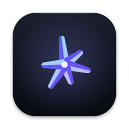
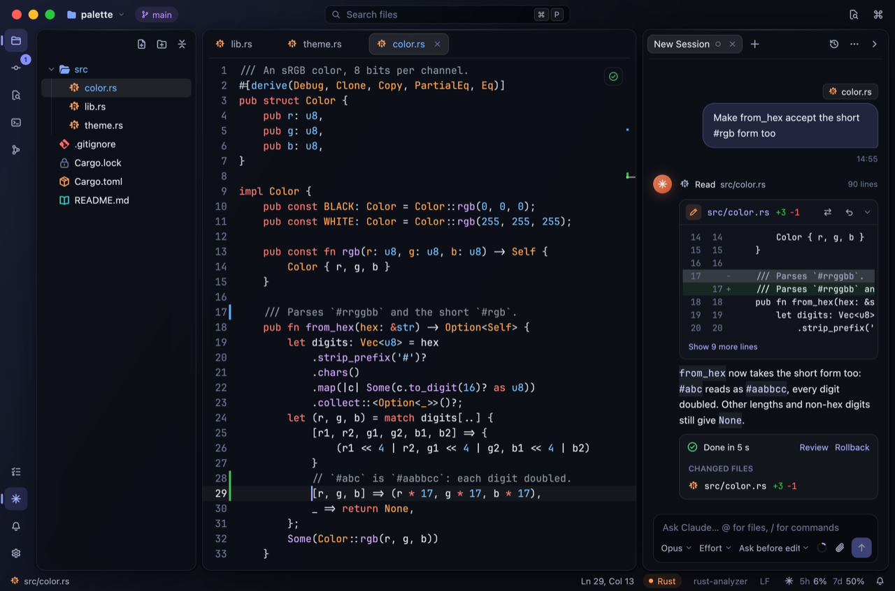

<div align="center">



# Flux

**A fast, native code editor for macOS — a complete Git workflow and Claude Code, built in.**


</div>

<p align="center">
  
</p>

## Features

### Fast and native

A Mac app written in Rust and drawn by the GPU: Flux opens instantly, and typing, scrolling and
searching never wait, even in files with tens of thousands of lines. Find a file by a few letters of
its name, search the whole project with a live preview, run any command from the palette — the
keyboard comes first and every action shows its keys, in English or Russian.

### Understands your code

Errors as you type, completion, go to definition, find usages and rename — from language servers Flux
installs by itself. <kbd>⌥</kbd><kbd>↵</kbd> on an error offers the quick fixes, and the scrollbar maps
the file's errors, warnings and changes.

### Git, all of it

A commit window with changelists and checkboxes down to single changes, a side-by-side diff you can
edit, every branch operation in one popup, a three-way merge tool, a log with a graph and an
interactive rebase, and who changed each line right in the gutter.

### Claude Code, built in

A native chat that runs your own `claude` with your Claude subscription — no API key. Sessions open
as editor tabs; the Claude console (<kbd>⌘</kbd><kbd>Esc</kbd>) lists them with what each one is doing,
lets you answer Claude's questions without leaving your file, and keeps the project's history. Closing
a tab doesn't stop Claude. Every edit Claude proposes opens as a diff you accept or trim, and everything it changed
gathers in its own changelist to review, roll back or commit. <kbd>⌥</kbd><kbd>↵</kbd> asks Claude to
fix or explain the code right where it is.

### Plugins in a sandbox

Plugins run as WebAssembly: they can't crash Flux and reach only what you allowed when you installed
them. The Marketplace brings languages, color themes and file icons in one click — and integrations
such as [Yandex Tracker & Calendar](https://github.com/egor4geev/flux-plugins/tree/main/plugins/flux.yandex).
Write your own in Rust: [Writing plugins](docs/plugins.md).

### A terminal built in

Your own shell with its prompt and colours, under the editor or as a tab next to your files
(<kbd>⌥</kbd><kbd>F12</kbd>). Split it, search its output, and ⌘-click a `file:line` from a compiler
or a test run to jump right there.

## Install

Download the `.dmg` from the [latest release](https://github.com/egor4geev/flux/releases/latest) —
`macos-aarch64` for Apple silicon, `macos-x86_64` for Intel — open it and drag Flux to Applications.
Flux needs macOS 12 or later.

Flux isn't notarized by Apple, so macOS blocks the first launch of a downloaded Flux, saying it can't
verify the app. Once:

1. Open Flux and close the message.
2. Open **System Settings → Privacy & Security**, find the note that Flux was blocked and click
   **Open Anyway**.
3. Confirm with your password or Touch ID.

Since macOS 15, Control-click → Open no longer gets past this. From then on Flux updates itself: it
tells you when a new version is out, and **Update and Restart** installs it without asking again.
Want the versions still being tried? **Settings → Updates → Channel: Beta**.

On its first launch Flux opens a short guide: the interface language, the theme and the look of the
window, the plugins of the languages you write in, Claude Code, and a few slides on working in Flux —
each with a live task. It is always at hand in **Help → Welcome Guide**.

## Build from source

You need [Rust](https://rustup.rs) with the WebAssembly target for the built-in plugins
(`rustup target add wasm32-wasip2`; without it Flux builds without them), [CMake](https://cmake.org)
(`brew install cmake`) and the Xcode Command Line Tools.

```sh
git clone https://github.com/egor4geev/flux.git
cd flux
scripts/bundle-macos.sh
open target/release/Flux.app
```

`main` follows the releases; development happens on `pre-release`. Open a folder with
<kbd>⌘</kbd><kbd>O</kbd> or pick a recent project on the start screen. For Claude, install
[Claude Code](https://code.claude.com) and sign in once.

## Feedback

- **Found a bug?** Help → Report a Bug… opens the form on GitHub with your version of Flux and your Mac
  already filled in — or [open an issue](https://github.com/egor4geev/flux/issues/new/choose) yourself.
- **An idea or a question?** Help → Suggest a Feature… and Ask a Question… take you to
  [Discussions](https://github.com/egor4geev/flux/discussions).
- **A problem with a plugin from the Marketplace?** The catalog's plugins have their own issues in
  [flux-plugins](https://github.com/egor4geev/flux-plugins/issues).
- **A security issue?** Please report it privately, as [SECURITY.md](SECURITY.md) explains.

## Contributing

Pull requests are welcome — read [CONTRIBUTING.md](CONTRIBUTING.md) first. They go to the
`pre-release` branch, not `main`.

## License

[MIT](LICENSE)
